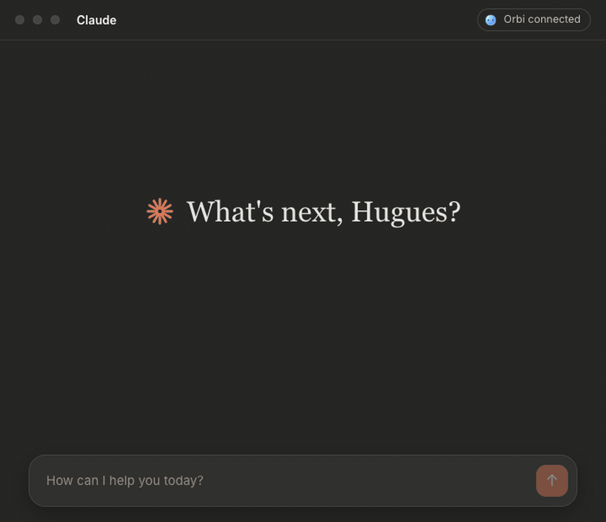
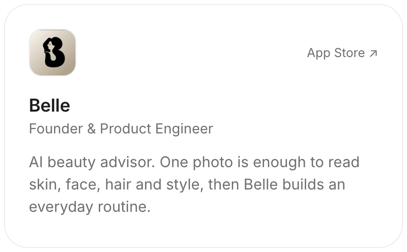
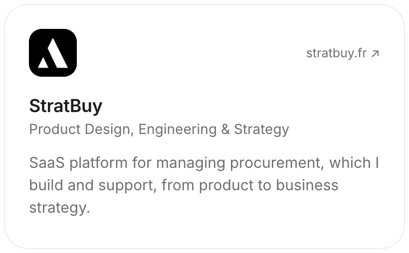
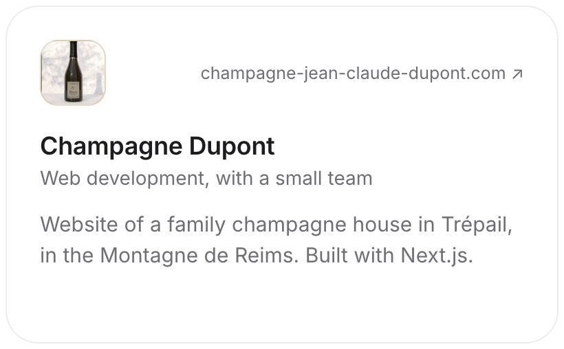
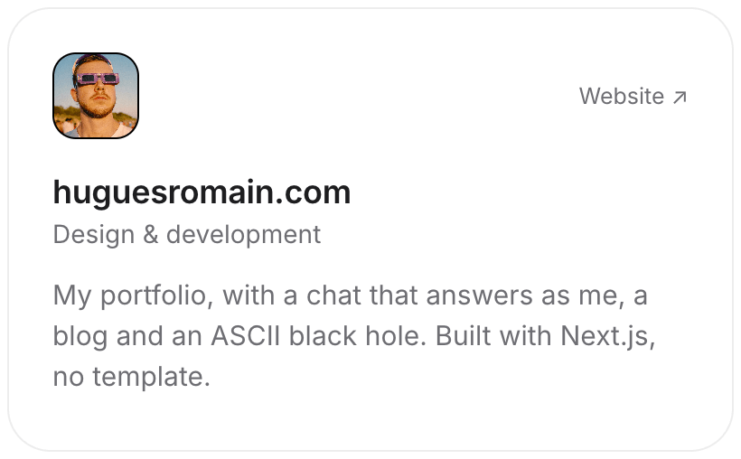
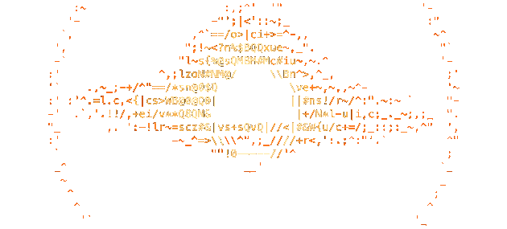

<a href="https://huguesromain.com/en"><picture><source media="(prefers-color-scheme: dark)" srcset="assets/header-dark.svg"></picture></a>

  <b>Freelance senior software engineer and AI specialist in Nice.</b> 
  I design and build web and mobile products end to end, with AI agents running in production. 
  🟢 Available for work · remote friendly

  <a href="https://huguesromain.com/en">Website</a> ·
  <a href="https://www.linkedin.com/in/huguesromain/">LinkedIn</a> ·
  <a href="https://calendly.com/huguesromain">Book a call</a> ·
  <a href="https://huguesromain.com/cv-hugues-romain-en.pdf">CV</a> ·
  <a href="mailto:huguesromaindev@gmail.com">Email</a>

 

##  [Orbi](https://www.get-orbi.com/en)

A prompting coach for companies that lives right inside teams' AI assistants. It steps in when a prompt can be improved, turns the best methods into shared skills and shows the company its progress, **without ever reading conversations**.

  <picture><source media="(prefers-color-scheme: dark)" srcset="assets/chips/mcp-dark.png"></picture>
  <picture><source media="(prefers-color-scheme: dark)" srcset="assets/chips/nextjs-dark.png"></picture>
  <picture><source media="(prefers-color-scheme: dark)" srcset="assets/chips/typescript-dark.png"></picture>
  <picture><source media="(prefers-color-scheme: dark)" srcset="assets/chips/supabase-dark.png"></picture>
  <picture><source media="(prefers-color-scheme: dark)" srcset="assets/chips/stripe-dark.png"></picture>
  <picture><source media="(prefers-color-scheme: dark)" srcset="assets/chips/copilot-dark.png"></picture>

 

##  [Recto AI](https://apps.apple.com/app/id6830776835)

Understand what you read without putting your book down. Photograph the page, highlight the hard passage, and **the AI explains it and keeps it**, book by book. In English, French and Chinese.

  <picture><source media="(prefers-color-scheme: dark)" srcset="assets/chips/expo-dark.png"></picture>
  <picture><source media="(prefers-color-scheme: dark)" srcset="assets/chips/typescript-dark.png"></picture>
  <picture><source media="(prefers-color-scheme: dark)" srcset="assets/chips/supabase-dark.png"></picture>
  <picture><source media="(prefers-color-scheme: dark)" srcset="assets/chips/mlkit-dark.png"></picture>
  <picture><source media="(prefers-color-scheme: dark)" srcset="assets/chips/revenuecat-dark.png"></picture>

 

## Also in production

  <a href="https://apps.apple.com/app/id6774620885"><picture><source media="(prefers-color-scheme: dark)" srcset="assets/cards/belle-dark.png"></picture></a>
  <a href="https://stratbuy.fr"><picture><source media="(prefers-color-scheme: dark)" srcset="assets/cards/stratbuy-dark.png"></picture></a>
  <a href="https://www.champagne-jean-claude-dupont.com"><picture><source media="(prefers-color-scheme: dark)" srcset="assets/cards/champagne-dupont-dark.png"></picture></a>
  <a href="https://huguesromain.com/en"><picture><source media="(prefers-color-scheme: dark)" srcset="assets/cards/site-dark.png"></picture></a>

I have also worked on [Sinea Formation](https://huguesromain.com/en/experience/sinea), [aiOrigin](https://huguesromain.com/en/experience/aiorigin), [Ida](https://huguesromain.com/en/experience/ida) and [theTribe](https://huguesromain.com/en/experience/thetribe).

 

## Stack

  <picture><source media="(prefers-color-scheme: dark)" srcset="assets/chips/typescript-dark.png"></picture>
  <picture><source media="(prefers-color-scheme: dark)" srcset="assets/chips/python-dark.png"></picture>
  <picture><source media="(prefers-color-scheme: dark)" srcset="assets/chips/react-dark.png"></picture>
  <picture><source media="(prefers-color-scheme: dark)" srcset="assets/chips/nextjs-dark.png"></picture>
  <picture><source media="(prefers-color-scheme: dark)" srcset="assets/chips/expo-dark.png"></picture>
  <picture><source media="(prefers-color-scheme: dark)" srcset="assets/chips/tailwind-dark.png"></picture>
  <picture><source media="(prefers-color-scheme: dark)" srcset="assets/chips/fastapi-dark.png"></picture>
  <picture><source media="(prefers-color-scheme: dark)" srcset="assets/chips/nestjs-dark.png"></picture>
  <picture><source media="(prefers-color-scheme: dark)" srcset="assets/chips/nodejs-dark.png"></picture>
  <picture><source media="(prefers-color-scheme: dark)" srcset="assets/chips/postgresql-dark.png"></picture>
  <picture><source media="(prefers-color-scheme: dark)" srcset="assets/chips/supabase-dark.png"></picture>
  <picture><source media="(prefers-color-scheme: dark)" srcset="assets/chips/prisma-dark.png"></picture>
  <picture><source media="(prefers-color-scheme: dark)" srcset="assets/chips/redis-dark.png"></picture>
  <picture><source media="(prefers-color-scheme: dark)" srcset="assets/chips/claude-dark.png"></picture>
  <picture><source media="(prefers-color-scheme: dark)" srcset="assets/chips/mcp-dark.png"></picture>
  <picture><source media="(prefers-color-scheme: dark)" srcset="assets/chips/temporal-dark.png"></picture>
  <picture><source media="(prefers-color-scheme: dark)" srcset="assets/chips/docker-dark.png"></picture>
  <picture><source media="(prefers-color-scheme: dark)" srcset="assets/chips/stripe-dark.png"></picture>
  <picture><source media="(prefers-color-scheme: dark)" srcset="assets/chips/railway-dark.png"></picture>
  <picture><source media="(prefers-color-scheme: dark)" srcset="assets/chips/github-actions-dark.png"></picture>
  <picture><source media="(prefers-color-scheme: dark)" srcset="assets/chips/sentry-dark.png"></picture>
  <picture><source media="(prefers-color-scheme: dark)" srcset="assets/chips/posthog-dark.png"></picture>

 

## Contact

An architecture to challenge, an agent to ship, a product to build end to end? Write me, I answer fast: **[huguesromaindev@gmail.com](mailto:huguesromaindev@gmail.com)**

  

