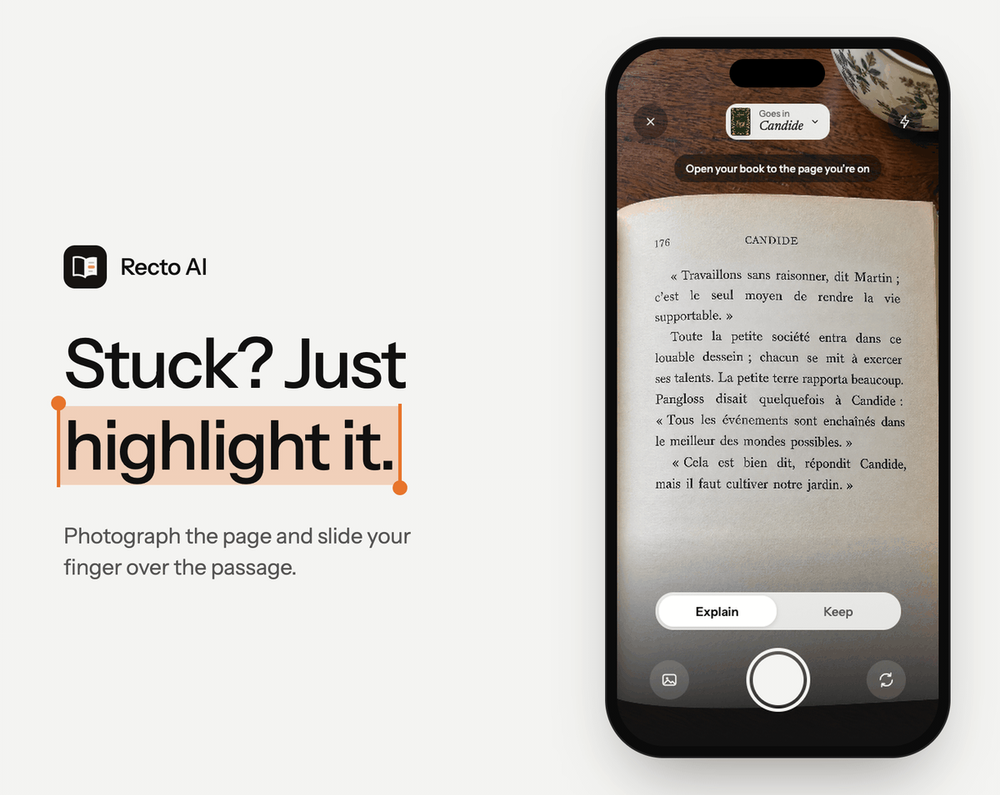

<a href="https://huguesromain.com/en"><picture><source media="(prefers-color-scheme: dark)" srcset="assets/header-dark.svg"></picture></a>

I design and build web and mobile products end to end, with AI agents running in production. Freelance in Nice, available for work, remote friendly.

Questions? [My site has a chat that answers as me](https://huguesromain.com/en), or [book a call](https://calendly.com/huguesromain).

<br>

###### VENTURES

<a href="https://www.get-orbi.com/en"></a>

**[Orbi](https://www.get-orbi.com/en)** · Founder & Product Engineer · since 2026<br>
A prompting coach for companies that lives right inside teams' AI assistants. It steps in when a prompt can be improved, turns the best methods into shared skills and never reads the conversations.<br>
<sub>MCP server and in-chat widgets, Next.js, Supabase, Stripe, Microsoft 365 Copilot agent</sub>

<br>

<a href="https://apps.apple.com/app/id6830776835"></a>

**[Recto AI](https://apps.apple.com/app/id6830776835)** · Founder & Product Engineer · on the App Store<br>
Understand what you read without putting your book down. Photograph the page, highlight the hard passage, and the AI explains it and keeps it, book by book. In English, French and Chinese.<br>
<sub>React Native / Expo, on-device text recognition with ML Kit, Supabase, RevenueCat</sub>

<br>

<table>
  <tr>
    <td width="72" align="center"><a href="https://apps.apple.com/app/id6774620885"></a></td>
    <td><b><a href="https://apps.apple.com/app/id6774620885">Belle</a></b> · Founder & Product Engineer · on the App Store<br>AI beauty advisor. One photo is enough to read skin, face, hair and style, then Belle builds an everyday routine.</td>
  </tr>
</table>

<br>

###### CLIENTS

<table>
  <tr>
    <td width="72" align="center"><a href="https://stratbuy.fr"></a></td>
    <td><b><a href="https://stratbuy.fr">StratBuy</a></b> · Product Design, Engineering & Strategy · 2026<br>SaaS platform for managing procurement, which I build and support, from product to business strategy.</td>
  </tr>
  <tr>
    <td width="72" align="center"><a href="https://www.champagne-jean-claude-dupont.com"></a></td>
    <td><b><a href="https://www.champagne-jean-claude-dupont.com">Champagne Dupont</a></b> · Web development, with a small team<br>Website of a family champagne house in Trépail, in the Montagne de Reims.</td>
  </tr>
</table>

Earlier: [Sinea Formation](https://huguesromain.com/en/experience/sinea), [aiOrigin](https://huguesromain.com/en/experience/aiorigin), [Ida](https://huguesromain.com/en/experience/ida), [theTribe](https://huguesromain.com/en/experience/thetribe).

<br>

###### STACK

```
languages   TypeScript · JavaScript · Python · SQL
front       React · Next.js · React Native / Expo · Tailwind CSS
back        FastAPI · NestJS · Node.js · PostgreSQL · Prisma · Redis
ai          Claude Agent SDK · MCP · LiteLLM · RAG · Temporal
infra       Docker · Stripe · Railway · EAS · GitHub Actions
```

###### CONTACT

[huguesromaindev@gmail.com](mailto:huguesromaindev@gmail.com) · [LinkedIn](https://www.linkedin.com/in/huguesromain/) · [CV](https://huguesromain.com/cv-hugues-romain-en.pdf) · [huguesromain.com](https://huguesromain.com/en)
