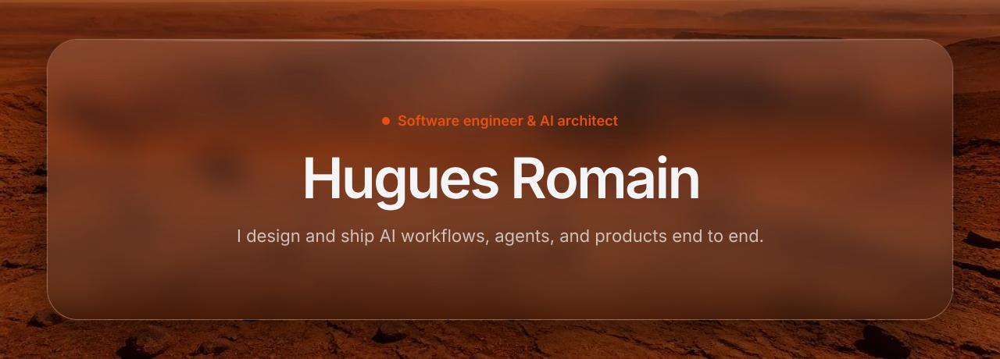

<p align="center">
  <a href="https://huguesromain.com">
    
  </a>
</p>

<p align="center">
  <a href="https://huguesromain.com/en">EN</a>
  ·
  <a href="https://huguesromain.com/fr">FR</a>
  ·
  <a href="https://huguesromain.com">huguesromain.com</a>
</p>

<p align="center">
  <a href="https://huguesromain.com/en">
    
  </a>
</p>

<br />

🟢 **Available for work** · Nice · remote friendly

Software engineer and AI architect, freelance in Nice. I build web and mobile products end to end, and I design and ship AI workflows and agents. Freelance under [Axiome](https://huguesromain.com/en/experience/axiome), co-founder of [aiOrigin](https://huguesromain.com/en/experience/aiorigin).

<br />

## Work

**[aiOrigin](https://huguesromain.com/en/experience/aiorigin)** — Co-founder & Lead Engineer  
Multi-tenant SaaS for autonomous AI agents in the enterprise.

**[Sinea Formation](https://huguesromain.com/en/experience/sinea)** — Lead Full-Stack Engineer  
B2B platform for employee soft skills. Mobile, API, and back office.

**[Axiome App Studio](https://huguesromain.com/en/experience/axiome)** — Founder & Product Engineer  
Consumer apps designed, built and shipped solo — Belle, Koji, KnuckleMax.

<br />

## Stack

**Languages** — TypeScript, JavaScript, Python, SQL  
**Front** — React, Next.js, React Native / Expo, Tailwind  
**Back** — FastAPI, NestJS, PostgreSQL, Redis  
**AI** — Claude Agent SDK, MCP, LiteLLM, RAG, Temporal

<br />

## Contact

An architecture to challenge, an agent to ship, a product to build end to end — write me, I answer fast.

**[huguesromaindev@gmail.com](mailto:huguesromaindev@gmail.com)**  
[LinkedIn](https://www.linkedin.com/in/huguesromain/) · [Book a call](https://calendly.com/huguesromain)

<br />

```
    .:.
   :=+=:
  :#   #:
 :#     #:
:#=======#:
```
